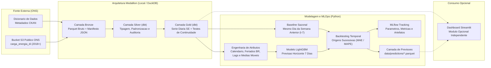

# Arquitetura do Sistema — Energy Forecast

## 1. Visao Geral

O projeto **Energy Forecast** foi estruturado para resolver o problema de previsao de carga eletrica diaria do subsistema Sudeste/Centro-Oeste (`SE`) para o horizonte de 7 dias com separacao rigorosa de responsabilidades entre ingestao, transformacao analitica, engenharia de atributos, modelagem preditiva e avaliacao temporal.

O diagrama a seguir ilustra o fluxo ponta a ponta entre as camadas de dados e os componentes do sistema:

---

## 2. Detalhamento da Arquitetura Medallion

### 2.1 Camada Bronze (`data/bronze/`)

- **Objetivo:** Preservar fielmente os dados brutos publicados pelo ONS desde janeiro de 2018.
- **Formato de Armazenamento:** Arquivos Apache Parquet (`.parquet`) particionados/organizados por arquivo anual original (ex.: `CARGA_ENERGIA_2018.parquet`, `CARGA_ENERGIA_2019.parquet`, ...).
- **Imutabilidade de Conteudo:** Os nomes originais das colunas, valores textuais e representacoes originais sao preservados sem filtragem silenciosa ou alteracoes artificiais.
- **Idempotencia e Manifesto:** Um arquivo separado `data/bronze/ingestion_manifest.json` registra para cada artefato ingerido:
  - URL de origem no S3/CKAN;
  - Ano/periodo de referencia;
  - Tamanho em bytes e hash SHA-256 do arquivo bruto;
  - Quantidade de registros e colunas;
  - Timestamp UTC da ingestao.
- **Reexecucao Incremental:** Antes de baixar novamente um arquivo historico consolidado, o processo de ingestao pode verificar sua integridade ou atualizar os anos correntes/recentes de forma deterministica.

### 2.2 Camada Silver (`dbt/models/silver/`)

- **Objetivo:** Padronizar tipos, validar regras de negocio basicas e garantir rastreabilidade ate a camada Bronze.
- **Motor de Execucao:** `dbt-core` com adaptador `dbt-duckdb`, lendo diretamente os arquivos Parquet da Bronze por meio de `read_parquet()` no DuckDB.
- **Transformacoes Previstas:**
  - Conversao explicita da coluna de data (`din_instante`) para o tipo `DATE`;
  - Conversao da coluna de carga (`val_cargaenergiamwmed`) para `DOUBLE` / `DECIMAL`;
  - Normalizacao de strings nos identificadores de subsistema (`id_subsistema`, `nom_subsistema`);
  - Adicao de colunas de auditoria e linhagem (arquivo de origem na Bronze, timestamp de processamento e flags de validacao);
  - Identificacao explicita de eventuais registros invalidos (ex.: carga nula ou negativa) ou duplicidades de chave `(id_subsistema, din_instante)` sem descarte silencioso.

### 2.3 Camada Gold (`dbt/models/gold/`)

- **Objetivo:** Disponibilizar a serie temporal diaria limpa, continua e certificada do subsistema `SE` pronta para modelagem e avaliacao.
- **Granularidade:** 1 linha por data (`data_referencia` / `din_instante`) para o subsistema `SE`.
- **Atributos Essenciais:**
  - Chave temporal (`DATE`, unica e nao nula);
  - Codigo do subsistema (`SE`);
  - Carga diaria em `MWmed`;
  - Metadados de verificacao de continuidade temporal (diferenca em dias em relacao a observacao imediatamente anterior para detectar lacunas na serie).
- **Contratos e Testes dbt:**
  - `not_null` e `unique` na chave temporal;
  - `not_null` na variavel alvo de carga diaria;
  - Teste singular/customizado no dbt (`dbt/tests/`) garantindo ausencia de saltos temporais (`gap > 1 dia`) entre o inicio e o fim da serie.

---

## 3. Estrategia de Engenharia de Atributos e Previsao sem Vazamento Temporal

Para prever um horizonte de $H = 7$ dias ($t_0 + 1, t_0 + 2, \dots, t_0 + 7$) a partir de uma data de origem $t_0$:

1. **Restricao Causal Estrita:** Nenhuma informacao observada em datas $t > t_0$ pode ser utilizada no calculo de lags, medias moveis, imputacoes ou selecao de hiperparametros.
2. **Alinhamento de Lags ao Horizonte ($h \in \{1 \dots 7\}$):**
   - Para que uma unica definicao de atributos seja valida para todos os dias do horizonte $h \in \{1, \dots, 7\}$ sem depender de previsoes recursivas intermediarias (ou utilizando estrategia direta/multi-horizonte alinhada a origem), um lag de $L \ge 7$ dias relativo a data alvo $\tau = t_0 + h$ referencia a data $\tau - L = t_0 + h - L$.
   - Como $h \le 7$ e os lags iniciais considerados sao $L \in \{7, 14, 28\}$, temos sempre $\tau - L \le t_0 + 7 - 7 = t_0$. Portanto, os lags de **7, 14 e 28 dias** em relacao a data alvo $\tau$ utilizam exclusivamente valores reais ja observados ate a data de origem $t_0$!
   - De forma equivalente, as estatisticas de janelas moveis (medias moveis de 7, 14 e 28 dias) sao ancoradas na data de origem $t_0$ (ou em $\tau - 7$), garantindo que apenas observacoes ate $t_0$ entrem no calculo.
3. **Atributos Deterministicos de Calendario:**
   - Dia da semana ($0 \dots 6$), mes ($1 \dots 12$), dia do mes, dia do ano, indicador de fim de semana e indicador de feriado nacional brasileiro (`holidays.Brazil`) sao conhecidos de antemao para qualquer data alvo $\tau = t_0 + h$ e nao configuram vazamento temporal.

---

## 4. Protocolo de Backtesting e Rastreamento no MLflow

O motor de avaliacao (`src/energy_forecast/evaluation/`) executa validacao temporal por janelas expansivas (expanding window walk-forward validation):

1. Define-se uma sequencia cronologica de datas de origem de previsao $t_0^{(1)} < t_0^{(2)} < \dots < t_0^{(K)}$ separadas por um passo configuravel (`step_days`, ex.: 7 dias).
2. Para cada origem $t_0^{(k)}$:
   - Filtra-se o conjunto de treinamento com observacoes estritamente $\le t_0^{(k)}$;
   - Ajusta-se o modelo LightGBM nesse historico;
   - Gera-se a previsao para o horizonte $[t_0^{(k)} + 1, \dots, t_0^{(k)} + 7]$;
   - Calcula-se a previsao do Baseline Sazonal ($\hat{y}_{t_0^{(k)} + h}^{\text{baseline}} = y_{t_0^{(k)} + h - 7}$) para as mesmas datas;
   - Compara-se ambas as previsoes com os valores reais observados no periodo de teste.
3. Calcula-se **MAE** e **MAPE** globalmente e para cada horizonte $h \in \{1, \dots, 7\}$, alem do ganho percentual:
   $$\text{Melhoria (\%)} = \left( \frac{\text{Erro}_{\text{Baseline}} - \text{Erro}_{\text{LightGBM}}}{\text{Erro}_{\text{Baseline}}} \right) \times 100$$
   Caso o valor seja negativo em algum horizonte ou no agregado, o relatorio explicita que o modelo apresentou desempenho inferior ao baseline.
4. Todos os parametros, metricas agregadas, metricas por horizonte e artefatos de previsao sao registrados no **MLflow**.

